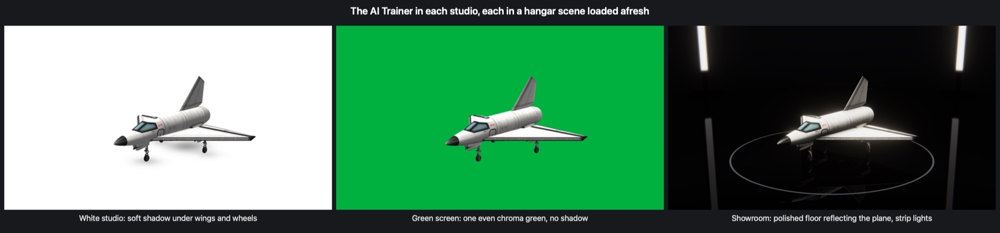
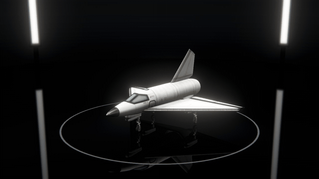

# Photo Studio

Your craft in a photographer's studio: a seamless white backdrop, a green screen, or a dark showroom with a polished
floor. A camera that goes round the craft, a turntable, and pictures up to four times the size of the screen, with a
see-through background if you want one. In the assembly building, in the hangar and in flight.

For Kerbal Space Program 1.12.x. **Needs [Keystone](https://github.com/IshiakiZ/ksp-keystone)**, a separate download
([on SpaceDock](https://spacedock.info/mod/4665/Keystone)): this mod does not load without it.

## Install

Copy the `PhotoStudio` folder from the download into your KSP's `GameData`, beside `Keystone`.

## Use

Press **Alt-P** (Option-P on a Mac), or press **Open the studio** on the mod's page in the Keystone window.

* **Right mouse button** turns round the craft, the **wheel** goes nearer and further, the **middle button** raises
  and lowers the view.
* **Alt-S** takes a picture. It goes into the game's `Screenshots` folder as a PNG.
* **Alt-1, 2, 3:** the white studio, the green screen, the showroom. **Alt-T:** the turntable. **Alt-P** or
  **Escape** closes the studio.

The mod's page has the lens, the aperture, the side the light comes from, the picture's size and the see-through
background.

## Good to know

* Closing the studio puts everything back as it was. In flight the game is paused while the studio is open; in the
  assembly building and the hangar, parts cannot be picked up meanwhile.

## Works on

Windows 11 (Direct3D 11 and OpenGL) and Mac: tried. Linux: never run.

**More:** [the long description](docs/The-long-description.md) (everything in full, and what
was tried on each system) and the rest of the [wiki](docs/README.md).

## Licence

[CC BY 4.0](LICENSE): use it, change it and pass it on as you like, as long as you credit Ishiaki and link back here.
