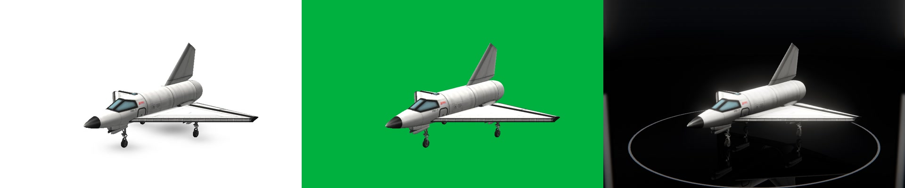
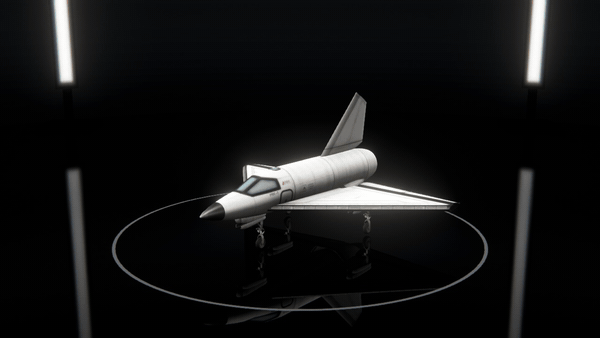

# Photo Studio

Your craft in a photographer's studio: a seamless white backdrop, a green screen, or a dark showroom with a polished
floor. A camera that goes round the craft, a turntable, and pictures up to four times the size of the screen, with a
see-through background if you want one. In the assembly building, in the hangar and in flight.

For Kerbal Space Program 1.12.x. **Needs [Keystone](https://github.com/IshiakiZ/ksp-keystone) 0.9 or later**, a separate download
([on SpaceDock](https://spacedock.info/mod/4665/Keystone)): this mod does not load without it.

## Install

Copy the `PhotoStudio` folder from the download into your KSP's `GameData`, beside `Keystone`.

## Use

Press **Alt-P** (Option-P on a Mac), or press **Open the studio** on the mod's page in the Keystone window.

* **Right mouse button** turns round the craft, the **wheel** goes nearer and further, the **middle button** raises
  and lowers the view.
* **Alt-S** takes a picture. It goes into the game's `Screenshots` folder as a PNG. **Turntable loop** (0.2.0, on the
  mod's page) turns the craft once round and writes it there as a GIF that loops, for a mod's page or a message.
* **Alt-1 to 5:** the white studio, the green screen, the showroom, your picture (0.2.0: a PNG or JPG of your own
  behind the craft, from `GameData/PhotoStudio/PluginData/Backdrops`), outdoors (0.2.0: in sunshine on a concrete apron).
  **The light** (0.2.0, on the page): soft, hard, low-key or sunset. **Alt-T:** the turntable. **Alt-P** or
  **Escape** closes the studio.

The mod's page has the lens, the aperture, the side the light comes from, the picture's size and the see-through
background. With Keystone 0.11.0, four finer details in its Advanced view: the key light's, the fill light's and the rim
lights' strength, and how dark the craft's own shadows are. [All of them](https://github.com/IshiakiZ/ksp-photo-studio/wiki/Settings).

**Anything in the game, alone** (in flight, on the mod's page): the craft near by and the space centre's buildings, nearest
first; pick one and everything else is taken away from the game's own cameras where it stands (or only the ground, or
everything solid, leaving clouds, smoke and flames), with the sky or a plain grey, black, white or blue behind it and the
game's clock stopped if you like. **Everything back** puts it all as it was.

## Good to know

* Closing the studio puts everything back as it was. In flight the game is paused while the studio is open; in the
  assembly building and the hangar, parts cannot be picked up meanwhile.

## Works on

Mac: tried. Windows 11 (Direct3D 11 and OpenGL): 0.1.0 tried; what 0.2.0 adds, not yet. Linux: never run.

**More:** [the long description](https://github.com/IshiakiZ/ksp-photo-studio/wiki/The-long-description) (everything in full, and what
was tried on each system) and the rest of the [wiki](https://github.com/IshiakiZ/ksp-photo-studio/wiki).

## Licence

[CC BY 4.0](LICENSE): use it, change it and pass it on as you like, as long as you credit Ishiaki and link back here.
