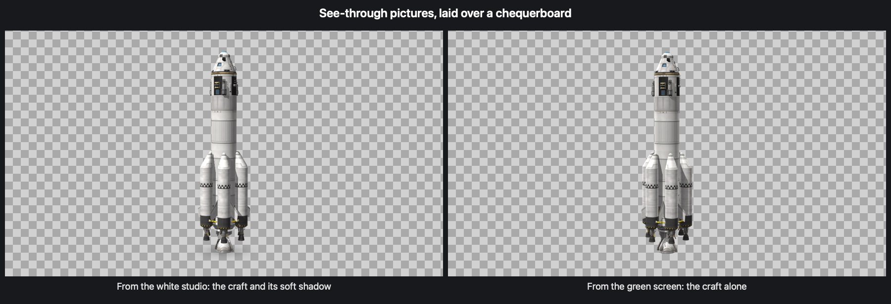

# Photo Studio

Your craft in a photographer's studio: a seamless white cyclorama, a green screen, or a dark showroom with a
polished floor that reflects it. A camera that goes round the craft, a turntable, and pictures larger than the
screen, with a see-through background if you want one. In the assembly building and the hangar (the building
and its crew go away while the studio is up), and in flight round the craft you are flying, with the game
paused. Closing the studio puts everything back exactly as it was.

For Kerbal Space Program 1.12.x. Needs [Keystone](https://github.com/IshiakiZ/ksp-keystone), a separate download ([its page on SpaceDock](https://spacedock.info/mod/4665/Keystone)): this mod does not load without it.

## Install

Install [Keystone](https://github.com/IshiakiZ/ksp-keystone) first: it is a download of its own, and its `Keystone` folder goes into your KSP
`GameData`. Then copy the `PhotoStudio` folder from this mod's download into `GameData` beside it.

## Use

Press **Option-P** (Alt-P on Windows and Linux), or open the Keystone window (the keystone button on the
toolbar, or Option-K), turn to **Photo Studio** and press **Open the studio**.

* **Right mouse button**: turn round the craft, and up and down. **Wheel**: nearer and further. **Middle
  button**: raise or lower the view. The game's camera keys work too.
* **Option-Return** or **Option-S** (on Windows **Alt-S**: Alt-Return never reaches a mod there): take a
  picture. It goes into the game's `Screenshots` folder as a PNG.
* **Option-1, 2, 3**: the white studio, the green screen, the showroom. **Option-T**: the turntable.
* **Option-P** or **Escape**: close the studio.

On the mod's page: which **studio**, the **lens** (18 to 200 mm) and **aperture** (depth of field), which side
the **key light** comes from, a **turntable**, the picture's **size** (up to four times the screen's), a
**see-through background** (white studio and green screen), the white backdrop's brightness, the shadow's
strength, the screen's colour and the showroom floor's gloss.

## Good to know

* Everything in it is drawn with the game's own shaders and lights, from shapes worked out by the mod: no
  shader of its own and nothing meant for one system only. (Depth of field is Keystone's lens.)
* While the studio is open in the editor its picking and moving of parts is held off and its panels are put
  away; saving, loading and launching still work. In flight the game is paused while the studio is open. The
  game's glow on a part under the pointer is held off while the studio is open, so it is never in a picture.

## Where it works

| System | |
| --- | --- |
| Mac | Made and tried here (KSP 1.12.5, OpenGL). |
| Windows | Tried on Windows 11 (KSP 1.12.5, Direct3D 11), in the assembly building and in flight: the three studios, pictures saved by the page's button and by Alt-S, the keys (Alt-P, Alt-1 and 2, Alt-S, Escape, the arrow keys), no glow with the pointer on the craft, and after closing no input lock left and the game's own glow back. With the game started on OpenGL (`-force-glcore`), the showroom and Keystone's lens. Then in the hangar with a plane: the turntable (Alt-T), and a see-through picture four times the screen (5120 x 2880, its background clear and the plane's soft shadow kept). |
| Linux | **Never run.** |

More: [the studios](docs/The-studios.md),
[settings](docs/Settings.md),
[pictures](docs/Pictures.md),
[how it works](docs/How-it-works.md),
[limits](docs/Limits.md),
[building it yourself](docs/Building.md).

## Licence

[CC BY 4.0](LICENSE): use it, change it and pass it on as you like, as long as you credit Ishiaki and link back here.
