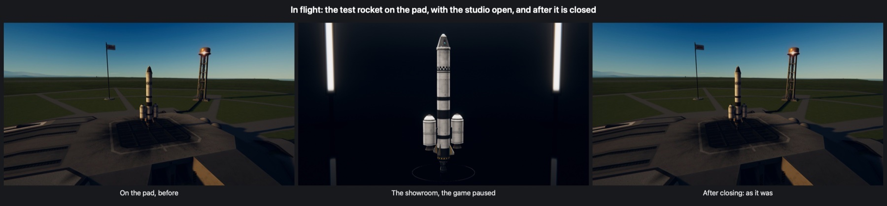

# How it works

## In the editor, while the studio is up

The assembly building and the hangar are drawn by two cameras: one draws the building itself (its light was
worked out once by its makers and painted onto it), the other, the editor's own, draws the craft and the
ground crew over it, lit by the building's lamps. A third draws the markers of the centres of mass and lift.
The studio changes as little of that as it can, and writes down each thing before it changes it, with what it
was, so that closing the studio puts every one of them back, last first:

* the camera that draws the building and the markers' camera are switched off; the editor's camera no longer
  draws the crew and their trucks, draws the studio's set instead (on a layer of the game's that nothing else
  uses), and clears its own depth (the building's camera cleared the picture for it). Nothing of the building
  or the crew is itself touched;
* the building's lamps that light the craft are switched off, and the studio's own lights are put in;
* the unseen sheet that takes the craft's shadow on the building's floor is hidden, and so are launch clamps
  (they would stand on the studio's floor as poles);
* the editor's camera is driven by the studio instead of by its own driver; its angle of view is the studio's
  lens, and it is no longer aimed a little to one side to leave room for the parts list (pictures are
  centred). The glow the editor puts round a part under the pointer is off;
* the light from all round (`RenderSettings`) is the studio's, and so is what the parts reflect (the editor
  gives them a picture of the building; the studio gives them one of itself, taken from where the craft
  stands);
* how far from the camera shadows are drawn is made to reach just past the craft (a setting of the whole
  game, put back on closing);
* the editor's picking up, placing, moving and undoing of parts is held off, so that a click meant for the
  camera does nothing to the craft; saving, loading, launching and leaving are not held off;
* the game's menu on Escape is held off (Escape closes the studio instead), and the game's interface is put
  away (if that setting is on).

The studio closes by itself, putting everything back, when the scene changes (launching, leaving the editor)
and if anything in it goes wrong. When the editor starts afresh (another craft loaded, a new one begun, the
other building), the studio is put away first and put up again round the new craft.

## In flight

The same, round the craft being flown, with these differences:

* the game is **paused** while the studio is up (as a game's photo mode pauses it), so the craft stands still;
* the planet, its sky and the distance go out of sight: the cameras that draw before the near one (the stars,
  the planet as seen from afar, the distance) are switched off, and the near camera draws only craft, kerbals
  and the set; other craft near by are hidden;
* the sun and every other lamp that would light the craft go out (looked over again twice a second while the
  studio is up, since other mods switch their own lamps on and off), and the light from all round is set
  again just before each of the studio's cameras draws (other mods set their own every frame);
* the flight camera is held (its own driver stops) and placed by the studio;
* the floor lies level under the craft across the planet's up where the craft is.

## The sets

Shapes worked out by the mod (surfaces turned round an upright line for the coves and the room, flat cards
for the softboxes, boxes for the stands), with pictures painted by the mod (the softboxes' diffusers, the
room's light up its walls), drawn with the game's own shaders: `KSP/Unlit` for everything that gives its own
light or must be one even colour, and the game's see-through particle shader for the shadow and the polished
floor. The set is laid out in proportion to the craft, and grows as the camera goes further out, so that the
camera is always inside it.

## The shadow under the craft (white studio)

Worked out when the studio opens, over a few frames: a grid of points on the floor under and round the craft,
from each of which 32 lines go up into the sky, spread as the light from a large soft source falls on a floor
(more steeply up than low). Each line that meets a part of the craft within a few metres darkens the point,
the more the nearer the part (the game's own ray casts against the parts' colliders). The grid is smoothed
and laid on the floor as a see-through black picture, which fades in. Before a picture is taken, any of it
still to be worked out is finished at once.

## The reflection in the showroom's floor

A second camera of the studio's draws first, before the main one: the same view turned over in the floor,
with its near plane laid in the floor so that nothing at or under it is drawn, and (since a mirror turns
things inside out) with front and back faces swapped while it draws. The main camera then draws the room, the
craft and, last, the floor, which is see-through by how much it reflects at each point: worked out each frame
from where the camera is, by Schlick's approximation of Fresnel's law (a polished floor reflects little
looking straight down and nearly everything at a glancing angle).

## The light

The craft is lit by the studio's own lamps, for the craft alone: a key light that casts its shadows on itself,
and in each studio some of a fill, a light from overhead and two from behind (the game's lamps shine from a
direction, as the sun does, which is the nearest the game has to a large softbox some way off). Real studio
lights are large, though, and light a thing softly from a broad patch of sky; that part of their light is
given as the light from all round: a spherical-harmonics probe (what the game's part shaders take their light
from all round from) holding some light from everywhere, more from above and from the floor, and broad lobes
from where the big lights stand, turned with them. The white studio's is light (a white room sends light back
from every side), the green screen's is neutral grey (nothing green comes back onto the craft), the
showroom's is dark but for the overhead softbox and the strip lights.

## The camera

It goes round the middle of the craft at a heading, a height angle and a distance, and follows what it is
asked smoothly. The set turns with it, so that the lights stay where a photographer would have put them for
that view (the key light in front and to one side, the lights from behind behind); turning round the craft is
therefore the same as the craft turning on a turntable in front of a still camera, which is what the
**Turntable** setting does by itself. With an **Aperture** wider than f/16, Keystone's lens blurs what is
nearer or further than the craft.
