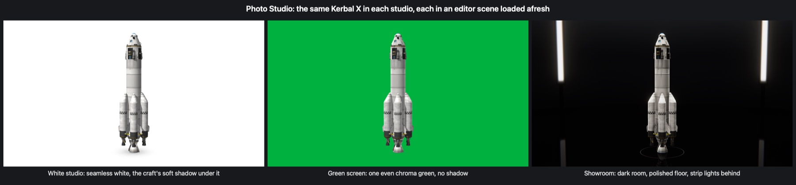

# The studios

Three sets, each made the way the real thing is lit and built, and each drawn with nothing but the game's own
shaders. All three are put up round the craft where it stands (in the editor, or in flight): the floor is laid
at the lowest point of the craft, and the set is centred under it.

## White

A **cyclorama** (an "infinity cove"): a floor that curves up into a wall all round, with no corner and no
horizon anywhere, so that the craft seems to stand in white without end. Product and car photographers light
the cove brighter than the subject, so that it comes out as pure white, and let the subject sit in the soft
shadow that their large lights leave under it.

* The cove is drawn unlit, at one even white (or a light grey: the **White backdrop** setting), so there is
  no seam, no falloff and no horizon to show.
* The **shadow under the craft** is worked out from the craft itself: from every spot of the floor under and
  round it, lines are drawn up into the sky in many directions (more steeply up than low, as light falls
  on a floor from large soft lights), and the more of them meet a part of the craft, and the nearer, the
  darker that spot (what renderers call ambient occlusion). So it is darkest where the craft comes down to
  the floor, a plane's wheels leave small dark spots and its wings a faint shade, and a rocket's base a
  dark ring fading out.
* The craft is lit by a large key light from the front, above and to one side (it casts the craft's shadows
  on itself), a weaker fill from the other side, a light from overhead, and a little from behind on both
  sides; the light from all round is light and even, as in a white room.
* What the craft's shiny parts reflect is the white studio itself, not the assembly building.

## Green screen

One even **chroma green** behind and under the craft, for cutting it out later with a keyer. Chroma-key
practice is followed where it applies to a picture drawn by a computer:

* The screen is one colour everywhere: it is drawn unlit, so no light falls off across it, and there is no
  shadow on it (the craft's shadow would be keyed as a hole). It is matt: nothing is reflected in it.
* Nothing green falls on the craft ("spill", the bane of real green screens): the light from all round is a
  neutral grey, and what the craft's parts reflect is the set in grey, not green.
* The craft is lit by its own lights, apart from the screen's: a key, a fill, and two strong lights from
  behind that draw a bright edge round it and part it from the green, as a backlight does in a studio.
* The game's post-processing (TUFX, where installed) is held off while the green screen is up: it would
  darken the corners, add glow round bright things and grade the colour, and the green would no longer be
  one green.
* The colour is chroma green, #00B140, to begin with; **Screen colour** can make it anything (chroma blue is
  #0047BB).

A see-through background (see [Pictures](Pictures.md)) does the keyer's work for you: the craft is cut
out cleanly, glass and soft edges included.

## Showroom

A dark **car studio**, of the kind cars are photographed in for brochures and shown in at dealerships:

* A floor polished like lacquer, in which the craft is **reflected**. The reflection is the craft (and the
  room) drawn a second time, as seen from under the floor, before everything else; the floor is laid over
  it, letting more of it through at a glancing angle than looking straight down, as a real floor does
  (Fresnel's law, in Schlick's approximation). **Showroom floor gloss** sets how much.
* A large **softbox overhead** (the "light curtain" that car studios hang over a car), the strongest light,
  casting the craft's shadows on itself.
* Two tall **strip lights** on stands behind the craft, to its left and right: they are what draws the bright
  edge along it, and they show, and are reflected in the floor, as they are in such photographs.
* A ring of light in the floor round the craft, where the edge of a **turntable** would be. With
  **Turntable** on, the craft turns slowly, as on a real one (the room, the lights and the camera stay).
* Dark walls with a softly lit band, curving down into the floor.

## What was looked at first, and what was taken from where

* **Kronal Vessel Viewer** (a KSP mod): pictures of the craft in the editor, from its own camera, on a plain
  background of a chosen colour, up to 4096 pixels. Taken from it: work on the craft being built, in the
  editor; a plain background; pictures larger than the screen. (It draws the craft flat, as a blueprint,
  and has an exploded view; this mod does neither.)
* **BOSS** and **Automated Screenshots** (KSP mods): screenshots several times the screen's size. Taken: the
  picture's size as a multiple of the screen's.
* **Camera Tools** (a KSP mod): camera moves in flight. Nothing taken: the studio's camera is for the editor.
  No KSP mod was found that puts a craft into a studio or takes the building away.
* **Gran Turismo's Scapes**: a car set into a photographed place whose light was measured, so that the car is
  lit by the place and its reflections answer to the place's lights, and does not look pasted on. Taken: the
  craft is lit by the set's lights, and its reflections are of the set itself.
* **Forza's photo mode and Forzavista**: a camera that goes freely round a still car; one car at a time in a
  showroom-like space. Taken: the orbiting camera, and the showroom.
* **Car and product photography**: the cyclorama lit brighter than the product, the soft shadow under it; for
  cars, a large overhead softbox, strip lights for the lines along the body and from behind, a dark room so
  that only the lights are reflected, a polished floor, a turntable. Taken: all of it, as above.
* **Chroma-key practice**: an evenly lit, matt screen (half a stop from edge to edge at most, in practice),
  no shadow on it, the subject lit apart from the screen and well away from it, backlight to part the
  subject's edges from the green, no green light on the subject. Taken: all of it (and the even screen is
  exactly even here, since it takes no light at all).
